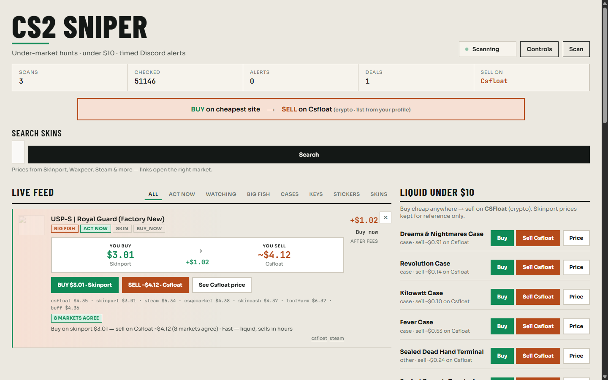
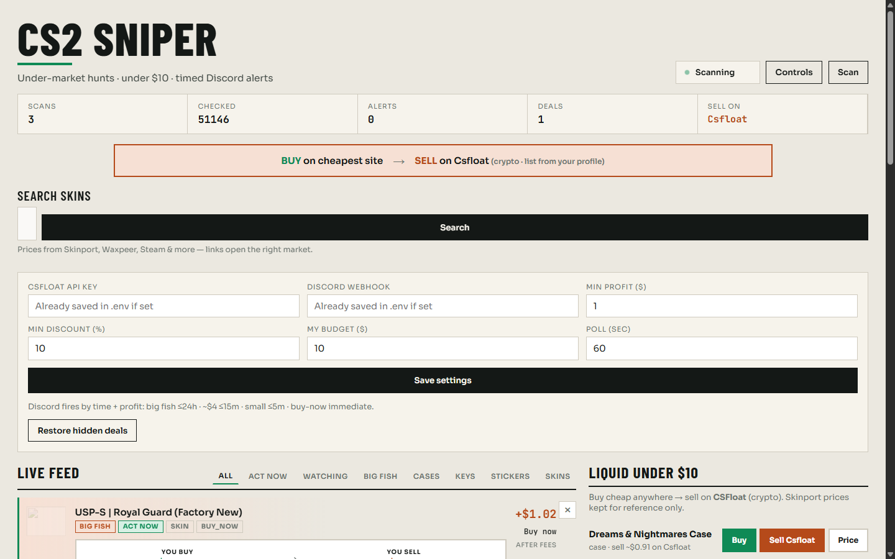
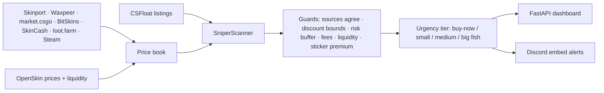

# CS2 Sniper

**A local dashboard + Discord alerter that hunts under-market Counter-Strike 2 items across eight
markets.** It watches the CSFloat listing feed, prices each candidate against a multi-market price
book, rejects the fake edges, and only pings you when the numbers still make sense after fees,
risk and liquidity.



## Why it exists

Cheap CS2 listings that are "60% under Steam price" are usually wrong: mismatched variants, dead
markets, sticker-premium traps, or a listing that will not sell in a week. This tool exists to be
boring about it: **a deal only surfaces when several independent markets agree on the sell price,
the item is liquid, and the profit survives fees and a risk buffer.**

No auto-buy. The dashboard and the Discord alert give you a link; you decide.

## What it does

- Polls **CSFloat** listings under a configurable budget, on a rate-limit-aware interval.
- Prices every candidate against a **multi-market price book**: Skinport, Waxpeer, market.csgo,
  BitSkins, SkinCash, loot.farm, Steam and OpenSkin (prices + liquidity + hot items).
- Filters with **anti-fake-profit guards** (see below) before anything reaches you.
- Sorts candidates into **urgency tiers** so Discord is only noisy when time matters.
- Sends **Discord embeds** with buy link, sell link, market-by-market price line, confirmed source
  count and expected net profit.
- Serves a **dashboard**: live feed tabs (All / Act now / Watching / Big fish / Cases / Keys /
  Stickers / Skins), local price **search** across the whole price book, a "liquid under $10" panel,
  controls for budget/profit/poll interval, and rejection telemetry.
- Handles rate limits gracefully: cooldown, exponential backoff, and a soft rate-limit mode instead
  of hammering the API.



## How it works



The server is **FastAPI + asyncio** with a background scanner task. Prices are cached in a local
price book (`data/`) so search and valuation do not hammer the market APIs.

### Anti-fake-profit guards

| Guard | Why |
|---|---|
| `MIN_SOURCES_AGREE` (3) | A price from one market can be an outlier; require independent agreement. |
| `MAX_DISCOUNT_PCT` (35) | Gaps beyond this are almost always bad data, not free money. |
| `PRICE_RISK_BUFFER_PCT` (8) | Assume you sell under the reference price after the trade hold. |
| Fees per venue | Net profit, not gross. CSFloat/Skinport/Waxpeer fees are modelled per venue. |
| Liquidity checks | `sell_orders`, bid volume, liquidity score, per-category thresholds. |
| Sticker premium cap | Do not pay for sticker value you cannot realise. |
| Excluded item types | Souvenir packages, autograph capsules, graffiti, patch packs. |
| Rate-limit backoff | A 429 means wait, not retry faster. |

### Discord urgency

| Tier | Condition | Notification |
|---|---|---|
| Buy now | Instant-buy listing | Immediately |
| Small | ≥ $2 profit | When ≤ 5 min left |
| Medium | ≥ $4 profit | When ≤ 15 min left |
| Big fish | ≥ $6 profit | When ≤ 24 h left |

Auctions with days left stay in the dashboard's **Watching** tab — no Discord spam.

## Quick start

Requires **Python 3.11+**.

```powershell
git clone https://github.com/Soophere/cs2-sniper.git
cd cs2-sniper
copy .env.example .env           # then fill in your keys (never commit .env)
python -m venv .venv
.\.venv\Scripts\activate
pip install -r requirements.txt
python -m server.main
```

Open **http://127.0.0.1:8765**.

## Configuration

Keys live only in `.env` (gitignored) or in the dashboard controls:

| Variable | Default | Meaning |
|---|---|---|
| `CSFLOAT_API_KEY` | — | Required for filtered listing search (csfloat.com → Profile → Developer) |
| `DISCORD_WEBHOOK_URL` | — | Optional; Discord alerts are skipped when empty |
| `MIN_PROFIT_USD` | 2.0 | Minimum net profit after fees |
| `MIN_DISCOUNT_PCT` | 10.0 | Minimum under-market discount |
| `MAX_BUY_USD` | 10.0 | Budget ceiling per item |
| `POLL_INTERVAL_SEC` | 60 | Scan interval |
| `MIN_SOURCES_AGREE` | 3 | Independent markets that must agree |
| `RATE_LIMIT_COOLDOWN_SEC` | 90 | Cooldown after a 429 |

Full list in [`.env.example`](.env.example).

## Security

- Real keys and the Discord webhook live in `.env`, which is **gitignored** and blocked by the
  patterns in [`.gitignore`](.gitignore). `.env.example` contains placeholders only.
- [`check-secrets.bat`](check-secrets.bat) is a quick pre-push scan for accidental commits.
- If a key ever leaks, rotate it on CSFloat and regenerate the Discord webhook.

## Limits (read this)

- **No auto-buy.** Buying is a manual click; the tool deliberately does not automate your account.
- Steam's trade hold means bought items cannot be resold for ~7 days — the price risk buffer
  exists because of that.
- Market APIs are unofficial/scraped public dumps; a price can be stale or withdrawn.
- This is a personal tool, not financial advice. CS2 item trading can lose money; use a budget you
  can afford to lose.
- The CSFloat API is required for live listing search; the public feed alone mostly shows expensive
  items.

## License

MIT — see [LICENSE](LICENSE).
